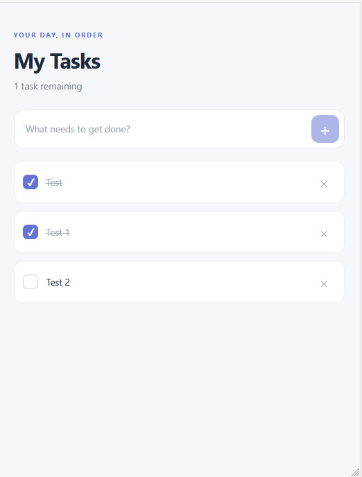
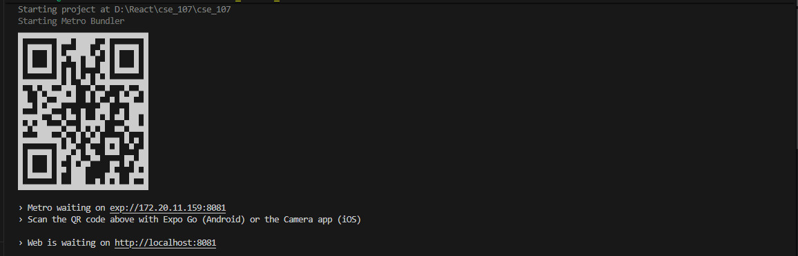

# Simple Todo

Simple Todo হলো React Native ও Expo দিয়ে তৈরি একটি সহজ task management app। এখানে নতুন task যোগ করা, task complete বা incomplete করা, এবং task মুছে ফেলা যায়। স্ক্রিনে অসমাপ্ত task-এর সংখ্যাও দেখা যায়।

## অ্যাপের ফিচার

- নতুন task যোগ করা
- task সম্পন্ন বা অসম্পন্ন হিসেবে চিহ্নিত করা
- task মুছে ফেলা
- অসমাপ্ত task-এর সংখ্যা দেখা
- task না থাকলে empty-state বার্তা দেখা

## প্রয়োজনীয় সফটওয়্যার

- [Node.js](https://nodejs.org/) (LTS সংস্করণ)
- npm (Node.js-এর সঙ্গে ইনস্টল হয়)
- মোবাইলে চালানোর জন্য [Expo Go](https://expo.dev/go), অথবা Android emulator
- Git

## GitHub থেকে project clone করা

টার্মিনালে project রাখার parent folder-এ গিয়ে নিচের command চালান:

```bash
git clone https://github.com/Alaminsarkar1/Todo-List.git
cd Todo-List
```

## Project চালানো

Project folder-এর ভেতরে নিচের command-গুলো চালান:

```bash
npm install
npx expo start
```

Expo চালু হলে:

- **ফোনে:** ফোন ও কম্পিউটার একই Wi-Fi নেটওয়ার্কে রেখে Expo Go দিয়ে টার্মিনালে দেখানো QR code scan করুন।
- **Android emulator-এ:** emulator চালু করে Expo টার্মিনালে `a` চাপুন।
- **iOS simulator-এ:** macOS-এ simulator চালু করে Expo টার্মিনালে `i` চাপুন।
- Expo-এর interactive terminal বন্ধ করতে `Ctrl+C` চাপুন।

## Project-এর ফাইল

```text
Todo-List/
├── App.js          # অ্যাপের UI এবং task পরিচালনার logic
├── app.json        # Expo app configuration
├── package.json    # project scripts এবং dependencies
└── photos/
    ├── 1.jpeg      # project-এর screenshot
    └── 2.jpeg      # project-এর screenshot
```

## Project-এর ছবি

### ছবি ১



### ছবি ২


